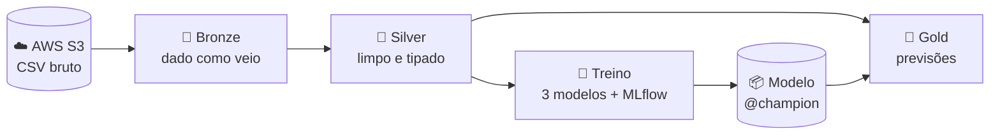

<div align="center">

# 📉 Client Churn · Databricks + AWS

**Pipeline de Machine Learning que prevê quais clientes vão cancelar o serviço**

*Do trabalho acadêmico na UFPR a um pipeline em produção na nuvem*


<br>


</div>

---

## 🧩 O problema

**Churn** é a perda de clientes. Numa operadora de telecom, cada cancelamento é receita recorrente que deixa de entrar,
e conquistar um cliente novo custa bem mais do que manter um antigo.

Este projeto identifica, **antes do cancelamento**, quais clientes ativos têm maior chance de sair. Assim a empresa
direciona as ações de retenção para quem realmente está em risco.

<div align="center">

| Entrada | ➜ | Saída |
|:---:|:---:|:---:|
| Perfil, serviços contratados, contrato e cobrança do cliente | 🤖 | **Probabilidade de churn** e **faixa de risco** |

</div>

---

## 📊 Os dados

| | |
|---|---|
| **Base** | [Telco Customer Churn](https://www.kaggle.com/datasets/blastchar/telco-customer-churn) (Kaggle / IBM) |
| **Clientes** | 7.043 |
| **Variáveis** | 4 numéricas + 15 categóricas |
| **Alvo** | `Churn` (cancelou ou não) |
| **Taxa de churn** | 26,5%, base desbalanceada |

<details>
<summary><b>Ver as variáveis</b></summary>
<br>

| Grupo | Variáveis |
|---|---|
| 👤 **Perfil** | `gender`, `SeniorCitizen`, `Partner`, `Dependents` |
| 📞 **Serviços** | `PhoneService`, `MultipleLines`, `InternetService`, `OnlineSecurity`, `OnlineBackup`, `DeviceProtection`, `TechSupport`, `StreamingTV`, `StreamingMovies` |
| 📄 **Contrato** | `tenure` (meses como cliente), `Contract`, `PaperlessBilling`, `PaymentMethod` |
| 💰 **Cobrança** | `MonthlyCharges`, `TotalCharges` |

</details>

---

## 🏗️ Arquitetura

Os dados ficam no **AWS S3** e são processados no **Databricks** em camadas (arquitetura medalhão), com todas as tabelas
em **Delta Lake** gerenciadas pelo **Unity Catalog**.



| Etapa | Tabela | O que faz |
|---|---|---|
| 🥉 **Bronze** | `bronze_clientes` | Lê o CSV do S3 sem alterar nada e registra arquivo de origem e data de ingestão |
| 🥈 **Silver** | `silver_clientes` | Tipagem, limpeza e checagens de qualidade que falham o job se algo vier errado |
| 🧠 **Treino** | MLflow + `churn_model` | Compara os modelos, registra cada execução e publica o melhor |
| 🥇 **Gold** | `gold_previsoes_churn` | Probabilidade de churn e faixa de risco de cada cliente ativo |

Tudo roda como um **único job** (`churn-pipeline`), definido em código com **Databricks Asset Bundles**.

---

## 🧹 Tratamento dos dados

Regras de negócio herdadas da [análise original](analise_original/):

- 🔍 **`TotalCharges` vazio** só acontece com `tenure = 0`, ou seja, clientes que ainda não receberam a primeira fatura. Esses valores viram **0**.
- 🔁 **Respostas equivalentes unificadas:** *"No internet service"* e *"No phone service"* → *"No"*.
- 🔢 **Alvo binário:** `Churn` vira 0/1.
- 🧽 Espaços removidos, tipos corrigidos e clientes duplicados descartados.

O pré-processamento fica **dentro do modelo**, então treino e previsão usam exatamente as mesmas transformações:

| Tipo | Transformação |
|---|---|
| Numéricas | `StandardScaler` |
| Categóricas | `OneHotEncoder` (aceita categorias novas sem quebrar) |

---

## 🧠 Modelagem

### Modelos comparados

| Modelo | Hiperparâmetros testados |
|---|---|
| 📈 **Regressão Logística** | Regularização `C` |
| 🌲 **Random Forest** | Número de árvores, profundidade, mínimo de amostras por folha |
| ⚡ **XGBoost** | Número de árvores, profundidade, taxa de aprendizado |

### Como os modelos são escolhidos

- ✂️ **Validação:** hold-out estratificado com 70% treino e 30% validação.
- 🔄 **Ajuste:** grid search com validação cruzada de 5 folds no treino.
- ⚖️ **Desbalanceamento:** peso maior para a classe minoritária (`class_weight` / `scale_pos_weight`), sem duplicar linhas.
- 🎯 **Métrica de escolha: F2**

> **Por que F2?** Deixar passar um cliente que vai cancelar custa mais caro do que oferecer retenção a quem ficaria.
> O F2 dá **mais peso ao recall** sem ignorar a precisão, e assim evita o modelo "preguiçoso" que marca todo mundo como churn.

O melhor modelo é registrado no **Unity Catalog** com o alias **`@champion`**, e é ele que o score usa.

---

## 🏆 Resultados

Desempenho na base de validação (30%, nunca vista no treino):

| Modelo | Recall | Precisão | F1 | F2 | ROC AUC |
|---|:---:|:---:|:---:|:---:|:---:|
| ⚡ **XGBoost** | **0,82** | **0,52** | **0,64** | **0,74** | **0,84** |
| 🌲 Random Forest | 0,81 | 0,51 | 0,62 | 0,72 | 0,84 |
| 📈 Regressão Logística | 0,80 | 0,51 | 0,62 | 0,72 | 0,84 |

<div align="center">

### 🎯 O modelo encontra **8 em cada 10** clientes que vão cancelar

</div>

Os três modelos ficaram próximos. Isso indica que o sinal está bem capturado pelas variáveis, sem depender de um algoritmo específico.

---

## 🚦 Classificação de risco

Cada cliente ativo recebe uma **probabilidade de churn** e uma **faixa de risco**:

| Faixa | Probabilidade | Sugestão de ação |
|---|:---:|---|
| 🟢 **Baixo** | até 40% | Relacionamento normal |
| 🟡 **Médio** | 40% a 70% | Acompanhar e oferecer benefícios pontuais |
| 🔴 **Alto** | acima de 70% | Prioridade para a equipe de retenção |

A tabela `gold_previsoes_churn` traz, por cliente: `customerID`, `prob_churn`, `previsao_churn`, `faixa_risco`,
`versao_modelo` e `calculado_em`.

---

## 📁 Estrutura

```
Client-Churn/
├── 📂 src/
│   ├── 📂 churn/            # features, pré-processamento, treino e avaliação
│   └── 📂 notebooks/        # 00_setup · 01_bronze · 02_silver · 03_treino · 04_score
├── 📂 resources/            # definição do job no Databricks
├── 📂 infra/                # script que cria o bucket S3 e sobe a base
├── 📂 data/                 # base Telco Customer Churn
├── 📂 tests/                # teste local do treino
├── 📂 analise_original/     # trabalho entregue na UFPR
└── 📄 databricks.yml        # configuração do bundle
```

---

## ⚙️ Como rodar

<details>
<summary><b>1 · Pré-requisitos</b></summary>
<br>

- [AWS CLI](https://aws.amazon.com/cli/) configurado com `aws configure`
- [Databricks CLI](https://docs.databricks.com/dev-tools/cli/install.html) logado com `databricks auth login --host https://SEU-WORKSPACE.cloud.databricks.com`

</details>

<details>
<summary><b>2 · Criar o bucket e subir a base</b></summary>
<br>

```bash
bash infra/aws_setup.sh NOME-DO-BUCKET
```

</details>

<details>
<summary><b>3 · Ligar o S3 ao Unity Catalog</b></summary>
<br>

No Databricks: **Catalog → External data → External locations → Create external location → AWS Quickstart**.
Informe `s3://NOME-DO-BUCKET` e siga o CloudFormation, que cria a role IAM e a credencial automaticamente.

</details>

<details>
<summary><b>4 · Configurar e executar</b></summary>
<br>

Preencha `host`, `catalog` e `bucket` em `databricks.yml` e rode:

```bash
databricks bundle deploy
databricks bundle run churn_pipeline
```

O job aparece em **Workflows**, os experimentos em **Experiments** e o modelo em **Catalog → seu catálogo → churn → Models**.

</details>

<details>
<summary><b>🧪 Teste local (sem Databricks)</b></summary>
<br>

```bash
pip install -r requirements.txt
pytest -s tests
```

</details>

---

## 🎓 Origem do projeto

Este projeto começou como trabalho da disciplina de **Machine Learning da UFPR**, com KNN, Naive Bayes, Random Forest e XGBoost
e seleção de variáveis por regressão Lasso. A análise completa, incluindo o relatório em PDF, está em [`analise_original/`](analise_original/).

---

<div align="center">

Feito com ☕, 🐍 e ☁️ por **Julio Cesar Fagundes**

</div>
